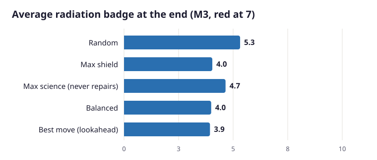

# Balance report

*Generated by `npm run sim -- --report --games 1000 --seed-start 1`. Kid scope (D-018…D-025), Cadet, all numbers from `src/engine/config.ts`.*

Targets in spec §1.4: no strategy wins more than 80 % · balanced play wins 60–75 % · pure greed (max-science, never repairs) loses most games · 70 % of the deck appears across 100 games · no two games identical · every card is the best pick somewhere. **P-007 asks the lead whether these targets still fit the kid game.**

## M3 · cadet

| Strategy | Mission Success | Safe Return | Brought home | Avg stars sent | Avg badge | Badge red | Events per game (min–max) | Ending reasons |
|---|---|---|---|---|---|---|---|---|
| Random | **59%** | 39% | 1% | 12.6 | 5.5 | 31% | 11.1 (7–13) | success 59%, highDose 28%, lowScience 11%, lsZero 1% |
| Max shield | **79%** | 2% | 19% | 21.3 | 4.5 | 2% | 11.1 (8–13) | success 79%, lsZero 19%, highDose 2% |
| Max science (never repairs) | **8%** | 64% | 28% | 24.5 | 8.2 | 84% | 10.6 (7–13) | highDose 64%, lsZero 28%, success 8% |
| Balanced | **54%** | 46% | 0% | 25.3 | 6.4 | 46% | 11.1 (8–13) | success 54%, highDose 46% |
| Best move (lookahead) | **52%** | 48% | 0% | 24.8 | 6.5 | 48% | 11.1 (8–13) | success 52%, highDose 48% |

- **Variety:** 9 of 10 scope events appeared across 100 random games (90 %); 96 different event lists out of 100.
- **Card coverage (best-move bot):** 15 of 20 Cadet cards chosen at least once; never chosen: FD-01.c, PW-03.a, PW-08.a, PW-08.b, LS-05.b.
- **No free lunch (static):** 30 of 30 cards in scope have a cost.

## M1 · cadet

| Strategy | Mission Success | Safe Return | Brought home | Avg stars sent | Avg badge | Badge red | Events per game (min–max) | Ending reasons |
|---|---|---|---|---|---|---|---|---|
| Random | **95%** | 4% | 1% | 12.0 | 5.0 | 20% | 7.7 (5–9) | success 95%, lowScience 4%, lsZero 1% |
| Max shield | **91%** | 0% | 9% | 21.8 | 4.8 | 2% | 8.0 (5–9) | success 91%, lsZero 9% |
| Max science (never repairs) | **81%** | 0% | 19% | 25.2 | 8.6 | 89% | 7.7 (4–8) | success 81%, lsZero 19% |
| Balanced | **100%** | 0% | 0% | 24.2 | 6.5 | 51% | 7.8 (5–9) | success 100% |
| Best move (lookahead) | **100%** | 0% | 0% | 23.4 | 6.5 | 49% | 7.7 (5–9) | success 100% |

- **Variety:** 7 of 8 scope events appeared across 100 random games (88 %); 84 different event lists out of 100.
- **Card coverage (best-move bot):** 11 of 16 Cadet cards chosen at least once; never chosen: FD-01.c, PW-03.a, PW-08.a, PW-08.b, LS-05.b.
- **No free lunch (static):** 24 of 24 cards in scope have a cost.

## Charts

