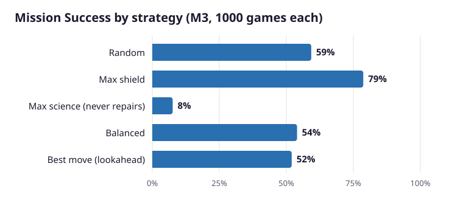

# Balance report

*Generated by `npm run sim -- --report --games 1000 --seed-start 1`. Kid scope (D-018…D-065), Cadet, all numbers from `src/engine/config.ts`.*

Targets in spec §1.4: no strategy wins more than 80 % · balanced play wins 60–75 % · pure greed (max-science, never repairs) loses most games · 70 % of the deck appears across 100 games · no two games identical · every card is the best pick somewhere. **P-007 asks the lead whether these targets still fit the kid game.**

## M3 · cadet

| Strategy | Mission Success | Safe Return | Brought home | Avg stars sent | Avg badge | Badge red | Events per game (min–max) | Ending reasons |
|---|---|---|---|---|---|---|---|---|
| Random | **2%** | 94% | 4% | 11.1 | 5.3 | 28% | 10.9 (6–12) | lowScience 94%, lsZero 4%, success 2%, highDose 1% |
| Max shield | **0%** | 93% | 7% | 13.9 | 4.0 | 0% | 11.0 (11–11) | lowScience 93%, lsZero 7% |
| Max science (never repairs) | **0%** | 0% | 100% | 18.3 | 4.7 | 13% | 9.4 (6–11) | lsZero 100% |
| Balanced | **74%** | 26% | 0% | 21.0 | 4.0 | 0% | 11.0 (11–11) | success 74%, lowScience 26% |
| Best move (lookahead) | **66%** | 34% | 0% | 20.6 | 3.9 | 0% | 11.0 (11–11) | success 66%, lowScience 34% |

- **Variety:** 22 of 24 scope events appeared across 100 random games (92 %); 77 different event lists out of 100.
- **Card coverage (best-move bot):** 25 of 48 Cadet cards chosen at least once; never chosen: SW-01.b, SW-02.b, SW-03.a, SW-04.b, SW-05.b, PW-01.b, PW-02.a, PW-02.b, PW-03.a, PW-07.b, LS-01.b, LS-03.b, LS-05.b, CR-02.b, CR-04.b, CR-05.a, CR-05.b, RS-01.b, MG-03.a, CR-03.a, CM-02.a, CM-02.b, CR-01.a.
- **No free lunch (static):** 72 of 72 cards in scope have a cost.

## Charts

